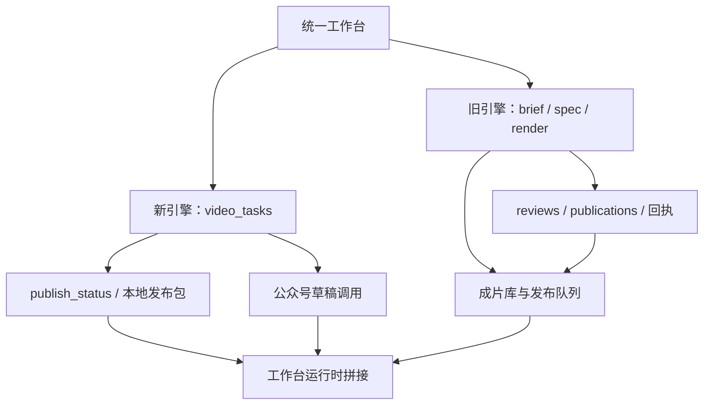

# 固定地址：全局问题清单 + 建议

审查日期：2026-11-11。审查基线：`main` / `6f4b56cd692b4173358fc69867ed2ec762b20dd0`，并核对当前工作区文件。行号对应本次阅读快照，后续修改可能移动。

本轮仅审查并编写本文：未改代码，未访问4310接口，未启动或停止服务，未打开或修改SQLite，未调用LLM/TTS/微信/第三方发布接口，未部署、未推送。

## 一、总体判断

软件已有可保留的基础：本地模板引擎、VibeMotion、任务表与工作台、账号组、素材管理、人工发布包、公众号草稿接口，以及已渲染的样片、三风格、图形库和模拟口型。当前主要问题是**各段能力存在，但“用户一次操作”所需要的状态、版本、资源和审批约束尚未贯穿**。

因此不建议重写项目，也不建议优先增加引擎或接付费数字人。下一阶段应先收紧外部写入边界与任务一致性，再把已验收的画面、真实配音时长和素材目录接回自动主链路。

### 证据标记

- **【代码核对】**：直接阅读当前实现，可以确定存在该分支或缺口；不等同于线上操作复现。
- **【本轮实测·只读】**：语法/类型检查、纯函数或文件元数据检查；没有创建任务、改数据库或发送内容。
- **【历史记录】**：项目内既有验证JSON、交付文档和用户先前验收；不能代替当前平台流程回归。
- **【推断】**：由代码路径推演出的影响，明确触发条件。
- **【未验证】**：需要真实账号、任务执行、浏览器交互或恢复演练后才能确认。

### 当前主链路的分叉

统一菜单和统一列表已经有价值，但目前还没有统一的内容实例、产物版本和发布状态契约。

## 二、最重要的五件事

1. **发布边界要可信**：区分模拟、草稿、提交中和已发布；创建草稿不能顺带正式发送，必须明确账号和人最后确认的动作。
2. **改稿和任务运行要可信**：新版本必须使旧配音、旧审批与旧发布准备失效；取消、重试、重启不能产生错版和假状态。
3. **自动生成要真正达到已验收质量**：先修空稿写作短路、两场景、整段字幕、样片硬编码和首帧封面，再扩充自动图形种类。
4. **两套引擎要共用一条内容与发布脉络**：保留两个执行器，先统一工作项、产物和发布记录的读写契约，不先做大规模表迁移。
5. **打通导入配音与资源可恢复闭环**：能选真实音频、按实测长度排时轴、重开项目重渲，并有完整的备份和资源引用记录。

## 三、按严重程度排序的问题

P0表示在继续批量生产/外部写入前应先防错；P1影响主链路正确性与可复用性；P2影响长期维护、体验和安全加固。排序针对当前本地自用产品，不假设已经公网部署。

### P0-01｜“创建公众号草稿”存在顺带提交正式发布的条件分支

- **现象【代码核对】**：旧引擎界面按钮和成功提示均以“创建草稿”表述；`publishWechat` 在账号 `autoSubmit=true` 且非dry-run时，会在 `draft/add` 后直接调用 `freepublish/submit`。路由只检查publication存在，没有在这一步重新核对当前产物审批和明确的“正式提交发布”确认。
- **影响【推断】**：配置满足上述条件时，用户以为只建草稿，却进入实际发布提交；这不符合“人最后确认发送”的产品边界。**未调用接口，不断言当前账号开关已打开，也不断言已发生误发。**
- **建议修法**：草稿创建与正式提交拆成独立命令；发送前展示账号、内容版本、素材摘要、dry-run/真实动作，绑定一次明确确认；服务端重查审批版本。现有autoSubmit路径先收敛到产品明确允许的范围。
- **证据**：`lib/wechat.mjs:203–282`，尤其274–276；`server.mjs:1504–1513`；`public/app.js:3006–3019`。

### P0-02｜引擎2把“草稿创建”记作“已发布”，账号和回执又没有贯穿

- **现象【代码核对】**：`publishVtaskWechat` 只执行草稿创建；路由对所有非dry-run结果却设置 `publish_status='published'`。该路由不接收目标账号，发布弹窗也无账号选择，函数因此使用默认公众号；`video_tasks` 没有账号/账号组字段。返回的media_id与账号信息没有形成引擎2的持久发布回执记录。
- **影响【推断】**：草稿被算作已发布，后续人工发送、回填链接和查错缺入口；多账号时可能发到非预期草稿箱；重复点击/网络超时重试可能重复建草稿。
- **建议修法**：采用 `dry_run → draft_created → publishing → published` 等清晰状态；让两引擎都写发布记录，包含账号、渠道、产物版本、media_id、最终链接和幂等键。未指定账号时拒绝真实写入；已指定但不存在时不要静默回退默认账号。
- **证据**：`server.mjs:1936–1945`；`lib/wechat.mjs:11–23,294–325`；`lib/db.mjs:146–172`；`public/app.js:1651–1675`。

### P0-03｜改文案重新生成时保留旧配音与旧发布状态

- **现象【代码核对】**：PUT video-task清空timeline和产物路径，却不清空 `voice_path`、`publish_status`。执行器见voice_path非空就不重新合成。旧文件仍在同一任务目录，新渲染继续使用同一id和文件名。
- **影响【推断】**：新字幕/画面可能配旧旁白；旧的“待发布/已发布”状态可能落在新文案上。运行中编辑还可能让旧作业的完成回调覆盖新版本状态。这是内容一致性问题，不是单纯的缓存问题。
- **建议修法**：增加内容revision与render-attempt，修改正文后明确使配音、分镜确认、审批和发布准备失效；渲染和配音缓存按正文/音色/参数哈希绑定；发布记录永远指向不可变产物版本，保留旧成片供回退。
- **证据**：`server.mjs:308–319,329–343,1918–1934`；`lib/vibemotion.mjs:185–188`。

### P1-04｜取消、重试、重启恢复没有形成可靠的任务状态机

- **现象【代码核对】**：引擎2取消只改数据库状态，不终止Remotion子进程；渲染完成仍无条件改done。retry没有限定当前状态，可以重复入队。队列是内存Promise链；启动恢复只处理旧renders和batches，未见video_tasks的queued/running恢复逻辑。
- **影响【推断】**：用户看到已取消，实际仍耗资源并最终变完成；重复执行会覆盖同一路径；服务重启后可能留下永远排队/运行的任务。旧引擎已有child跟踪和取消处理，应复用其经验。
- **建议修法**：统一状态转换表；任务持久化、领取锁/attempt-id、心跳和恢复策略；取消贯穿TTS、打包、Remotion进程树；完成回写必须验证attempt与当前状态。先保持单worker，不急于扩大并发。
- **证据**：`server.mjs:125–126,280–353,1903–1916,2139–2165`；对照旧引擎 `server.mjs:405–453`；`lib/vibemotion.mjs:168–175`。

### P1-05｜两引擎的内容实例、成片库和发布队列仍分裂

- **现象【代码核对】**：旧链路已有content_id、render和publication；video_tasks没有相同内容关联。`/api/library`和`/api/publish/queue`只查旧表，统一工作台则拼接三类实体。一个旧内容可能同时出现brief与publication；引擎2的发布结果不会自然进入旧发布页。
- **影响【推断】**：成片从哪里找、审批哪个版本、哪个账号已发过，依赖用户记忆；菜单合并不能消除底层状态差异。
- **建议修法**：先定义统一工作项DTO和产物/发布适配层：content_id、engine、revision、artifact_id、review_state、publication_id。两执行器保留；读模型统一后再增量补关联字段，不重建全库。
- **证据**：`server.mjs:191–217,1405–1426`；`lib/db.mjs:146–172,379–406`。

### P1-06｜空稿“自动写文案”被标题回填短路，默认自动编排又只有两场景

- **现象【代码核对】**：前端提示“留空可让AI自动写”，但创建接口先把空script填为title；执行器只有script为空才调用draftAutoScript，正常入口因此跳过该分支。即使有完整稿件，三风格默认分支也只生成process + ring两场景、一条覆盖全片的整段字幕和一个音效，无cameraKeyframe。
- **影响【推断】**：标题可被当作整篇稿件出片；长时间停在同一图上，字幕过长，无法达到8–12场景、每2–4秒有解释变化的目标。单独点击“AI写文案”按钮是另一条可用路径，不能据此认为留空提交已打通。
- **建议修法**：区分未提供稿件与显式稿件；写稿失败应停在可恢复阶段并给原因，不静默交付“标题稿”。提炼样片A的编排器，按语句/关系生成不等长场景与事件，分句字幕和每场景音效/镜头。
- **证据**：`server.mjs:294–299,1885–1891`；`public/app.js:1553–1554,1592–1606`；`lib/vibemotion.mjs:49–79`；`lib/generator.mjs:1020–1030`。

### P1-07｜通用画面仍带样片专属文案和默认数字，模板/字体选择存在旁路

- **现象【代码核对】**：GraphicScene顶部固定“让想法变成可靠结果”，底部重点句也固定；自动ring固定65等数值。合法style会在buildTimeline中提前return，后面的模板sceneFlow分支无法执行；GraphicScene字体来自styles.ts和硬编码正文，未跟随style.settings.json中的字体设置。
- **影响【推断】**：换成“设备采购”等主题仍出现样片主题；无数值稿件被配65%示意环；用户选模板/字体可能没有预期作用。批量风格生成还把industrial等内部id加到标题，可能带入成片。
- **建议修法**：将所有成片可见文字改成内容字段，演示默认值限定在demo项目；无数据时选择流程/对比，不能用通用百分比充当内容。明确style、template、font、density优先级，并用同一主题配置进入所有组件。
- **证据**：`src/graphics/GraphicScene.tsx:14,27`（下文src均指VibeMotion renderer/src）；`lib/vibemotion.mjs:49–82`；`server.mjs:332–338`；`public/app.js:1604–1606`。

### P1-08｜声音素材“可上传”尚不等于“可用作这条视频的配音”

- **现象【代码核对】**：声音库提供上传、试听、分组和归档；新建/编辑视频表单没有选择已有声音或导入整段配音的入口。上传声音在data/media/voice-assets，Remotion音频却由staticFile从renderer/public解析，没有统一资源解析/复制。时轴依据用户填的duration_ms，未见真实时长测量和逐句字幕对齐进入平台执行器。
- **影响【推断】**：无真实TTS Key时，普通用户缺少稳定的有声闭环；直接传voice_path也可能落在不可服务的路径。音频长短与视频不一致会造成截音或后段无声。
- **建议修法**：优先加入“选择配音/导入配音 → 测时长 → 确认断句 → 安排场景 → 出片”，用asset_id而非裸路径。复用样片中的实测时长方法，允许人工调句段；字数估算必须标记，不宣称精确对齐。
- **证据**：`public/app.js:1551–1569,1625–1643,1787–1841`；`server.mjs:308–319,2019–2031`；`lib/vibemotion.mjs:76–78`；`src/Video.tsx`的cleanSrc/staticFile音轨处理。

### P1-09｜“人工先确认分镜”缺少可审查、可修改的分镜界面

- **现象【代码核对】**：manual模式会保存timeline_json并进入pending_confirm；列表主要展示“确认并生成”按钮，点击直接POST confirm。编辑弹窗只有标题、稿件、结构、风格和时长，保存会丢弃timeline_json；没有可见的逐场景预览、标签、数据、时间与来源编辑器。
- **影响【推断】**：人工确认接近“同意开始渲染”，未必是在确认具体内容；人工精调也不能稳定保留。分镜确认与成片审批是不同闸门，目前容易混同。
- **建议修法**：先做轻量场景列表+关键帧预览，不开发专业剪辑器；支持改文案、图解、数据和时间，保存revision；服务端确认请求携带revision并校验，成片审批另行记录。
- **证据**：`server.mjs:320–327,1923–1932,1983–1990`；`public/app.js:1492,1621–1648`及confirm-video-task事件。

### P1-10｜渲染工作目录共享，失败和超时又可能卡住后续队列

- **现象【代码核对】**：每次写同一份src/data/timeline_dsl.json和style.settings.json，再编译。单server的Promise链能串行化其自身任务，但独立服务、CLI与其他进程不共享锁。runCommand未见spawn error监听、超时/abort与日志上限；render_service_url有设置项，实际仍固定CLI调用。
- **影响【推断】**：多入口同时渲染可能读错稿件/配色；一个挂起进程可能堵住整个串行队列；生产产物缺少可重放的输入版本。独立服务还允许调用方指定outDir，不能直接作为开放的多用户渲染接口。
- **建议修法**：先用全局渲染锁保护现状，随后每个attempt拥有独立输入快照和资源清单；子进程封装支持error、timeout、abort和限量日志。CLI与服务只选一个运行入口作为平台执行器，配置与实际行为一致。
- **证据**：`lib/vibemotion.mjs:8–10,168–210`；`vibemotion-service.mjs:20–25`；`server.mjs:334–338,1654`。

### P1-11｜平台封面仍取第0帧，没有接回样片封面能力

- **现象【代码核对】**：平台调用VibeMotion第0帧生成cover.png；全局场景在第0帧的入场opacity为0，往往主要剩底色/装饰。样片专用ChalkCover及两种尺寸并未被renderVibeMotion调用。fallback还把JPEG文件重命名为.png，而非真正转码。
- **影响【推断】**：渲染done不代表有可用封面；3:4封面缺失或只是后续裁补，上传工具可能遇到扩展名与内容不一致。
- **建议修法**：将封面组件参数化到同一项目数据，平台明确输出1080×1920与1080×1440；验证实际尺寸与文件格式。用语义关键帧作为兜底，避免0帧盲取和改后缀伪装格式。
- **证据**：`lib/vibemotion.mjs:199–206`；`src/Video.tsx`的enter/sceneStyle；`src/Root.tsx`的SampleACover入口；`src/components/ChalkCover.tsx`。

### P1-12｜引擎2缺少与旧引擎同等的内容/布局/媒体发布闸门

- **现象【代码核对】**：旧渲染链会执行runPreflight并记录结果；processVideoTask主要在CLI成功后直接done。未见对新DSL的唯一ID、时间连续性、事件越界、文字溢出、安全区、数据来源与资源存在性做统一校验。尚有旧组件使用48/64px边距、显示序号、循环漂浮。
- **影响【推断】**：样片抽帧合格不能保证任意稿件都合格；超长标题、错误数值或字幕仍可能进发布准备。未知组件兜底也可能把内部组件名称呈现给观众。
- **建议修法**：建立共同的“输入校验→渲染→ffprobe/抽帧→内容和视觉检查→人工批准”契约，区分警告与阻断；保留AGENTS的4/5/6页、5主题门槛，先按受支持模板逐项补齐，不降低字号或裁掉内容求通过。
- **证据**：`server.mjs:336–345,486`；`lib/preflight.mjs:125–174`；`src/components/FlowChart.tsx:36,81`；`src/components/KineticTypography.tsx:81–83`；`src/engine/registry.tsx`及Placeholder。

### P1-13｜45项图形有渲染能力，但目录、自动编排和控制参数未统一

- **现象【代码核对】**：新图形清单在public/graphics-catalog.json；旧element-catalog与/api/elements是另外两套概念。当前元素页读取/api/elements和/api/element-assets，未见消费45项清单；自动编排只用少量process kind和ring，未用完整新图形选择。decor/density/字体等存在各组件不同控制方式。
- **影响【推断】**：用户看到的“元素”不等于真正可调的渲染组件；新增图库不会自动改善生成质量，模板开关也可能只影响部分层。
- **建议修法**：保留旧资产，给所有目录提供统一视图和稳定elementId、propsSchema、预览、适用结构、密度和支持风格；导演只从校验后的目录选型。先打通5–7种常用图解，其他作为可手选扩展，不强求每条片塞满所有类型。
- **证据**：`public/app.js:2184–2206`；`lib/element-catalog.mjs`；`lib/vibemotion.mjs:53–79`；`src/graphics/catalog.ts`；`public/graphics-catalog.json`（后两者位于renderer内）。

### P1-14｜TTS错误被降级吞掉，头像开启缺少音频前置校验

- **现象【代码核对】**：TTS失败仅console记录“skipped”后继续渲染；供应商列表包括未实现项。avatar为true却没有真实音频时，AvatarOverlay会在渲染中报错；mock提供的是静音，嘴不动属于正确的能量响应，但不是可交付口播。task.voice_provider也未决定当前合成实现，实际读取全局设置。
- **影响【推断】**：用户不知道这次是字幕版、合成失败还是静音测试；开启头像后才晚期失败，浪费渲染时间。上传声音样本也不等于已自动训练/克隆音色。
- **建议修法**：供应商能力表只对已实现协议开放生产选项，真实Key测试状态持久化；按任务记录配音来源、时长、降级原因。头像开启先检查可用音频，mock必须标测试；暂不接付费精确数字人，先完成导入配音与真实头像校准流程。
- **证据**：`server.mjs:308–317`；`lib/tts.mjs:6–15,32–105`；`src/avatar/AvatarOverlay.tsx`；`public/app.js:1568,1815,2580`。精确口型仍不属于现有能力。

### P1-15｜合规关键词会误拦正常表述，且缺少可追溯的人工复核

- **现象【本轮实测·只读】**：“最后留下可检查的记录。”因包含“最”被拦；“保证百分百有效”也被拦。当前是子串匹配，不能理解上下文，也未覆盖素材、来源、最终文章和发布包的完整检查。
- **影响【推断】**：样片A含“最后”的原稿走平台时可能先被阻断；普通稿件误伤，复杂风险表述又可能漏检。用户容易形成绕过闸门的习惯。
- **建议修法**：将绝对化风险短语、上下文提醒、来源检查分层；返回位置、原因、建议改写和规则版本；允许人工复核但记录批准人/内容版本/原因。发布前再查最终版本，不能只在入队查一次。
- **证据**：`lib/compliance.mjs:1–6`；`server.mjs:301–304`。未把规则通过等同于法律或平台合规保证。

### P1-16｜本地文件边界与SVG输入校验需要收紧

- **现象【本轮实测·只读】**：复核safeJoin同样的path计算，`media-private`这类同前缀兄弟目录会被 `target.startsWith(base)` 接受。SVG校验能拒绝script和on事件，但无害的 `javascript:void(0)` 链接仍会通过；前端以innerHTML内联SVG。
- **影响【推断】**：静态文件隔离存在缺口；不可信SVG链接可能带来脚本URL风险。**未请求4310、未读取越界文件、未在浏览器执行SVG，也未证明能读任意磁盘文件。** 默认回环监听降低网络暴露面，不消除输入边界问题。
- **建议修法**：用path.relative和目录分隔符校验真实边界，必要时核对realpath；SVG用标签/属性允许列表并禁用脚本协议、外部资源和交互链接。增加Host/Origin与会话边界后再考虑非回环访问，不先建设复杂多租户系统。
- **证据**：`server.mjs:807–809,2102–2133`；`lib/elements.mjs:292–306`；`public/app.js:2199`。

### P2-17｜素材可以删，但缺少“哪些项目还在用它”的引用关系

- **现象【代码核对】**：图片/声音删除直接unlink后删除记录；未见检查任务、项目、发布包或配音轨引用。任务和DSL还大量保存裸路径，而非版本化asset-id。
- **影响【推断】**：已完成视频暂时可播放，过几天重渲却缺文件；用户清理素材可能破坏已批准项目的可恢复性。
- **建议修法**：区分归档、软删除和物理清理；建立项目到资源的引用清单、哈希与来源信息；有引用时禁止直接物理删除，或先把资源封装进不可变项目包。先实现引用可见，再增加批量清理。
- **证据**：`server.mjs:2040–2047,2089–2096`；`lib/db.mjs:157–160,175起media_assets定义`。

### P2-18｜备份有SQLite快照，但恢复包不完整且音乐索引命名不一致

- **现象【代码核对】**：backup使用VACUUM INTO获取DB快照，这一点应保留；另把音乐索引以basename `library.json` 保存，restore却寻找 `music-library.json`。媒体、上传资源、逐任务DSL和字体/模板版本不在备份包内；恢复脚本依赖操作者已停服务，没有自动核验。
- **影响【推断】**：干净环境恢复可能只恢复记录，资源丢失；音乐索引不会按当前脚本配对恢复。未进行恢复演练，不能宣称灾难恢复已验证。
- **建议修法**：统一manifest中的原相对路径、类型、尺寸与哈希；把原始上传、输入快照和关键项目资源纳入备份策略，大成片可分层归档；恢复前核对服务状态与WAL处理，先在隔离副本完整演练。
- **证据**：`scripts/backup.mjs:11–23`；`scripts/restore.mjs:11–24`。

### P2-19｜输出已累积到可见规模，没有容量与归档闭环

- **现象【本轮实测·只读】**：文件元数据统计：data/media约33,818个文件、5,111.9MiB；publish-kits约37.3MiB；renderer/out约91.4MiB；renderer/public/audio约10.2MiB。图片和声音已可分组/归档，但产物、临时输入、失败作业和配音缓存缺统一保留策略。
- **影响【推断】**：长期批量生产将增加备份时间、磁盘占用和清理误删风险；同任务覆盖、无效孤儿文件又混在同一路径下。
- **建议修法**：先加容量和引用报表，定义原始上传/确认项目/已发布版本/失败临时文件的不同保留期；清理先dry-run、列依赖、可恢复，不从递归删除开始。
- **证据**：上述目录只读遍历；`lib/vibemotion.mjs:179–186`；`server.mjs:329–342`。统计是当前快照，后续任务会改变。

### P2-20｜凭据有前端脱敏，但本地存储和访问边界仍需明确

- **现象【代码核对】**：settings与账号接口返回“是否配置”而不是明文Key，应保留；底层仍是SQLite普通文本，备份也包含这些值。服务默认127.0.0.1，但HOST可配置，路由没有统一身份/Origin保护层。当前账号开关与权限未实测。
- **影响【推断】**：数据库/备份被复制会连带泄露凭据；若以后绑定非回环地址，当前信任模型不足。这里**不是说已从接口读到Key或当前服务已公网暴露**。
- **建议修法**：保持本地回环默认；凭据使用系统保护存储/加密封装，备份访问权限和脱敏导出分开；错误日志不得回显敏感响应。对外访问前另设明确安全门槛，不把多用户权限系统放在主链路修复之前。
- **证据**：`server.mjs:32–33,1628–1667,2167–2177`；`lib/db.mjs:428–435`；`scripts/backup.mjs`。

### P2-21｜AI标识、来源和素材许可还没有成为发布资产的一部分

- **现象【代码核对】**：旧publications已有ai_label_status/platform_ref字段，部分第三方映射有AI标识参数；实际两条主发布路径没有形成一致的检查与回写。引擎2发布包主要是视频、封面和文案，缺版本、哈希、素材来源/授权和AI标识记录。资源目录仅找到通用README，未见逐项许可台账。
- **影响【推断】**：无法快速回答“这条视频用了哪些字体/插画/音乐、许可依据是什么、哪些部分由AI生成”。显示“来源：AI生成”不能代替事实出处或渠道元数据标识。
- **建议修法**：每个资源记录来源、作者、许可文本/URL、取得时间、适用范围和版本；每条内容生成发布检查单。人工上传包也携带AI标识提示和待回填链接。平台最新规范与实际账号权限另行核验，本轮没有做法律或渠道规则认证。
- **证据**：`lib/db.mjs:127–128,390–391`；`lib/publishers/mapping.mjs`；`server.mjs:1955–1972`；renderer/public/assets/README.txt。

### P2-22｜一页工作台仍会把人带回多套入口，状态展示也不完整

- **现象【代码核对】**：工作台用实体类型跳回autogen/brief/publish，很多vtask行无论状态均显示“准备发布”；素材库实际只查旧renders。autogen轮询只刷新任务列表，不更新统计数字；工作台没有相同刷新机制。顶部全局按钮仍是“新建选题”，不同于菜单“新建视频”。
- **影响【推断】**：用户会点到不支持的动作，刷新前数字过时；做完引擎2视频却在“素材库”找不到。问题不只是名字，还包括列表数据边界和操作状态。
- **建议修法**：以一条内容的详情面板承接输入、分镜、成片、审核、发布；按状态返回允许动作。列表只显示内容当前阶段，历史发布/版本放详情。将“素材库”明确成“成片版本”，与原始图片/声音区分；统一刷新同一个查询结果。
- **证据**：`public/app.js:1500–1535,1577–1585,1611–1618`；`public/index.html`顶部按钮；`server.mjs:1405–1426`。

### P2-23｜上传限制、配置作用域和长期可维护性需要一次小规模收口

- **现象【代码核对】**：声音上传是base64 JSON，受readBody约4,000,000字符限制，实际二进制上限更低；UI接受任意audio但未预先提示该限制。任务存在engine/palette/voice_provider等字段，执行器却固定走VibeMotion和全局配置。server/app各有大量路由与界面拼接；DB启动迁移大量catch空处理，并有启动时数据更新。
- **影响【推断】**：较大音频失败原因不清；设置看起来可选，实际行为不统一；跨品牌模板、声音和调性容易串用。迁移错误被吞掉后会在更晚阶段显现。
- **建议修法**：上传统一大小、格式、时长校验与明确错误，逐步改为文件流；定义全局/账号组/内容三级配置优先级。只按边界抽出任务、发布、资产模块，不换框架；迁移使用版本和事务，启动失败要可诊断。
- **证据**：`server.mjs:68–85,1888–1890,2020–2029`；`public/app.js:1826–1838`；`lib/tts.mjs:18–29`；`lib/db.mjs:284–406`。

### P2-24｜验证记录和版本文档会漂移，需要回到“当前平台一次完整任务”

- **现象【本轮实测·只读】**：server、public/app和lib模块语法检查通过；renderer当前tsc仍有2处错误：Diagram.tsx的hub比较、Video.tsx当前默认DSL配色结构与类型不符。index.ts的FontFaceSet类型问题已经修复，旧交付文档里的“三处错误”已过时。package版本2.2.1与界面2.3.1等标记也不一致。
- **影响【推断】**：独立样片成功、历史检查脚本成功，不等于当前新建任务→审批→发布包成功；版本和验收范围模糊，会重复修已修问题或误报能力。
- **建议修法**：统一app/schema/renderer/template版本元数据；任务产物保存输入、资源、配置和代码版本摘要。把少量关键回归用例固定下来：空稿、导入音频、改稿、取消/重试、重启恢复、双账号dry-run、两引擎发布包和同项目重开重渲。保留历史报告，但每项标注基线、日期和边界。
- **证据**：本轮 `tsc --noEmit --incremental false`；`src/index.ts`、`src/types.ts`、`package.json`、`public/index.html`；既有scripts和各ROUND交付文档。

## 四、对DSH清单的补充与校正

| DSH观点 | 本轮核对 |
| --- | --- |
| 两引擎数据与发布模型不统一 | 成立；进一步定位到引擎2草稿状态、账号、成片库和回执的具体断点。 |
| 样片质量没有完全接回平台 | 成立；默认编排只有2场景，且空稿写作短路、样片文案硬编码、封面第0帧是更直接的原因。 |
| 45项图形没全部自动用起来 | 成立；不建议一次随机启用45项，先统一目录与5–7个稳定选型。 |
| 声音/音乐也要分组归档 | 声音当前代码已经实现分组/标签/归档；真正缺口是任务引用、导入配音和资源生命周期。音乐再单独补齐，不重复做声音管理。 |
| 凭据泄露风险 | 本地明文存储风险成立；GET设置/账号已脱敏，不应写成“接口直接返回所有Key”。 |
| 公众号dry-run要小心 | 成立；更高优先级是“创建草稿”和“正式提交”的操作语义，以及引擎2错记published。 |
| 视频号保持手动上传 | 应保留；本轮没有新增自动视频号发布建议，也未核验外部平台API现状。 |
| GitHub网络不稳定，需要push | 网络状况本轮未验证；用户当前禁止推送，不列入明天必须动作。先做好本地快照和可恢复交付。 |

## 五、“明天统一行动”的建议顺序

不建议先合并全部页面，再处理发布和任务正确性。页面合并应建立在正确的状态与版本契约上。

| 顺序 | 建议动作 | 建议负责边界 | 可验收结果 |
| --- | --- | --- | --- |
| 0 | 汇总本报告与DSH清单；保存DB一致性快照、素材manifest和当前产物，确认禁止真实发送的测试策略 | DSH主导，用户确认生产边界 | 可回退基线与测试账号策略明确；不以push代替备份。 |
| 1 | 修发布：草稿/正式提交分开，账号必选，正确状态、回执、版本与幂等；视频号继续手动 | DSH服务端/界面 | 两账号dry-run无真实写入；草稿不会变published；重复点击不重复建对象。 |
| 2 | 修任务：revision/attempt、改稿失效、取消、重试和重启恢复；先维持单worker | DSH任务执行器 | 改稿不复用旧语音；取消不回done；旧attempt不能覆盖新版本；重启后有明确恢复/中断状态。 |
| 3 | 修自动质量：空稿写作、真实配音时长、分句字幕、8–12场景、封面双尺寸、阶段性视觉闸门 | Codex渲染编排；DSH输入输出对接 | 用平台新建而非CLI专用数据，生成一条接近样片A的片；有抽帧、声音和来源，能人工修订重渲。 |
| 4 | 补统一内容脉络与读模型，让成片库、审批、发布详情覆盖两引擎 | DSH | 同一内容只显示一个当前工作项；所有版本与渠道记录可追溯；两个引擎都能从工作台走到手动包/草稿。 |
| 5 | 合并目录与素材引用，优先5–7种图解自动选型；补配音选择/导入与用户头像校准入口 | 双方按渲染/平台边界 | 目录预览与实际生成一致；资源有引用；删除不破坏已保存项目。 |
| 6 | 补备份恢复演练、许可台账、合规复核与容量归档，再做剩余页面收敛和批量优化 | DSH主导，Codex提供检查结果 | 隔离恢复成功；授权与AI标识可查；清理先dry-run；工作台数据与统计一致。 |

**如果明天只能做三件事：发布边界 → 任务版本与取消 → 平台自动样片闭环。** 导入配音和统一publication/attempt关联应随这三件事一起落地，不拆成长期遗留项。

## 六、本轮执行记录与未验证范围

### 本轮只读实测

| 检查 | 结果与边界 |
| --- | --- |
| node --check server.mjs / public/app.js / lib递归mjs | 通过；仅语法，不证明业务正确。 |
| renderer tsc --noEmit --incremental false | 失败，当前2处类型错误；未改代码来消除。 |
| safeJoin同算法的path.win32计算 | 同前缀兄弟目录被接受；仅内存路径运算，无网络与文件越界读取。 |
| checkCompliance正常句/风险句 | “最后留下可检查的记录。”命中“最”；“保证百分百有效”命中相应短语。使用Unicode转义复核，避免PowerShell标准输入编码干扰。 |
| validateGeneratedSvg无害脚本URL字符串 | javascript:void(0)链接通过；仅验证函数返回值，没有执行该链接。 |
| 媒体目录文件元数据统计 | 见P2-19；未打开数据库或读取凭据。 |
| 既有验证记录存在性 | 样片A、ROUND4、ROUND5的validation.json均存在；属于历史记录，未在本轮重新生成或跑业务任务。 |

### 只作为历史记录使用

`engines/vibemotion/renderer/out/sampleA-project/validation.json`、`out/round4/validation.json`、`out/round5/validation.json`及相应交付文档证明渲染能力和某些受控样例曾通过验证；不能推导出最新自动入口、真实TTS、账号选择、发布回执和恢复机制都已通过。

### 本轮未验证

- 当前4310进程与磁盘代码是否同一版本、实际运行任务数量与状态；没有调用健康接口或业务接口。
- 当前数据库真实账号开关、凭据值、已发送内容、失败率及历史错误账目；没有打开DB。
- 微信/蚁小二真实权限与最新平台规则、真实群发/定时/回执；没有外部请求。
- 真实TTS/声音克隆、上传头像质量、任意稿件的排版与音画对齐；没有新建渲染任务。
- 跨入口并发串稿、取消和重启恢复、备份还原的实际复现；以上相关影响标为代码推演，需在隔离数据/假适配器中验证。
- 安全问题的浏览器利用、系统级密钥保护效果、素材授权适用性；本轮仅识别代码与台账缺口。

本文是可行动的问题清单，不是上线验收通过证明。后续建议保留既有成果，先补共同契约、明确失败和恢复路径，再扩大自动化规模。
